# DEEP TRACE


## Resumen

Las 10 etapas quedaron resueltas. La página final es `1b74e5175e672a5af64c7ea7808801e7.vercel.app`: es el MD5 de la clave `EVERY_ACTION_LEAVES_A_TRACE`, reconstruida con los 9 fragmentos Base64 repartidos por el reto.

THE DEEP TRACE es un *cyber mystery hunt* de XSec Solutions, patrocinado por TryHackMe: 10 etapas encadenadas a lo largo de 10 días.


| # | Nombre / URL | Técnica principal | Resultado |
| --- | --- | --- | --- |
| 01 | Intercept 001 (imagen) | ROT47 → Base64 → Vigenère `NULL` | URL de la etapa 02 |
| 02 | `xsec-deep-trace-stage-1.vercel.app` | Hex → steghide | contraseña `xsec` → URL de la 03 |
| 03 | `dead-frequency.vercel.app` | Morse en WAV | ZIP `silenceisnotempty` → URL de la 04 |
| 04 | `unwritten-trace.vercel.app` | OSINT de libro | ruta `/femtocell` |
| 05 | `unwritten-trace.vercel.app/femtocell` | Análisis de pcap | clave `packetghost` → URL de la 06 |
| 06 | `return-to-evidence.vercel.app` | Reutilizar evidencia + medir imagen | ruta `/1517` |
| 07 | `return-to-evidence.vercel.app/1517` | OSINT en LinkedIn e Instagram + XOR | `side-channel.vercel.app` |
| 08 | `side-channel.vercel.app` | Base64 → invertir → Vigenère + TryHackMe | `we-will-be-back-in-2027.vercel.app` |
| 09 | `we-will-be-back-in-2027.vercel.app` | `robots.txt` + fecha oculta | `/records/20260912214733/` |
| 10 | `…/records/20260912214733/` | Reconstruir fragmentos + MD5 | página de finalización |


### Cómo reproducir la investigación

Cada etapa tiene dos posibles resultados: una pista para avanzar y una pieza del mensaje final. Conviene guardar ambos; una URL válida no garantiza que se haya recuperado el fragmento acumulativo.

Los comandos siguientes están pensados para Linux/Kali, desde una carpeta de trabajo por etapa. Se utilizan `curl`, `7z`, `exiftool`, `steghide`, `tshark` y Python 3. Para visualizar el audio se puede usar Audacity. Los scripts auxiliares de esta página usan la biblioteca estándar de Python y se pueden descargar en un [paquete conjunto](scripts/deep-trace-scripts.zip).

Las imágenes de evidencia técnica representan registros obtenidos de los archivos locales del reto: combinan salidas ejecutadas y fragmentos del código fuente. No son capturas históricas de Kali ni imágenes generadas para inventar resultados. Se puede leer cada registro como texto y consultar sus hashes de origen en el [manifiesto de evidencias](evidence/manifest.json).

Las salidas se contrastaron con los artefactos descargados del reto. El fragmento 06 es una reconstrucción y se identifica como tal; las referencias a publicaciones externas conservan las limitaciones indicadas en su etapa.

## TRACE 01 y 02 — Intercept 001 y la imagen del Támesis

**TRACE 01.** La imagen inicial del canal de WhatsApp contiene una cadena de 60 caracteres firmada por "NULL". Se resuelve con tres capas: ROT47, después Base64 y por último Vigenère con la clave `NULL`. En Vigenère, la clave solo avanza con las letras; los demás caracteres se copian tal cual.

```text
5(d=*(*e{JhJ+wqH{)9H4v|E3>}D4w<E+v'F*)pE|$d?4>IF4w<F5(u9{Hll
→ ROT47:    dW5lYWY6Ly9yZHBwLXhwcGMtbmNscHktZGVuYXAtMS5ncmxucHkudWFhLw==
→ Base64:   uneaf://rdpp-xppc-nclpy-denap-1.grlnpy.uaa/
→ Vigenère: https://xsec-deep-trace-stage-1.vercel.app/
```

Los scripts auxiliares disponibles se enlazan en el procedimiento de la etapa.

### TRACE 01 · De la cadena a la dirección

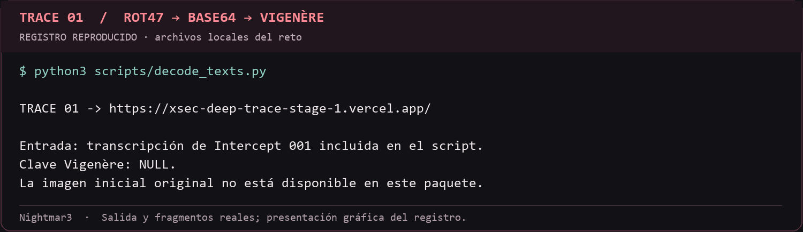

*Reproducción del descifrado sobre la transcripción conservada; no es una captura del Intercept original. Presentación gráfica de un registro reproducido, no captura histórica de una terminal.*

[Leer el registro en texto](evidence/trace01.txt).

**Qué orienta el análisis.** La firma `NULL` ofrece una posible clave, pero no demuestra por sí sola el orden de las capas. La cadena inicial contiene símbolos fuera del alfabeto Base64. ROT47 es una hipótesis que se puede comprobar: su salida pasa a tener un alfabeto Base64 válido y termina en `==`. Al decodificar, aparece una estructura parecida a una URL, aunque sus letras todavía están cifradas. Esa estructura permite comprobar la última transformación.

**Cómo repetirlo.** El [script de transformaciones textuales](scripts/decode_texts.py) contiene la cadena transcrita y el descifrado Vigenère. Guarda el archivo en `scripts/` y ejecuta:

```sh
python3 scripts/decode_texts.py
```

La primera salida debe ser `TRACE 01 -> https://xsec-deep-trace-stage-1.vercel.app/`. La misma utilidad reproduce también TRACE 07 y 08. En Vigenère se preservan `:`, `/`, `-`, los números y los puntos; estos caracteres no consumen posiciones de la clave. Si la clave avanza sobre toda la cadena, la URL queda mal descifrada.

**Comprobación y cierre.** El destino se identifica como el nodo 02 y ofrece el ZIP de evidencia. La cadena de entrada procede de la transcripción aportada; no se incluye una copia original verificable de Intercept 001 en este paquete. Aquí se obtiene un destino, no un fragmento acumulativo.

**TRACE 02.** La página ofrece `evidence_001.zip`, que contiene `thames_night.jpg`. Al pie aparece el fragmento hexadecimal `58 53 45 43`, que da `XSEC`.

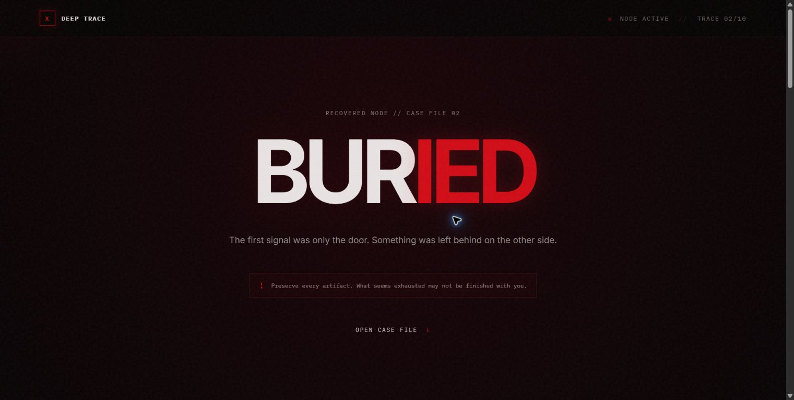


- Los metadatos EXIF, XMP y el comentario JPEG repiten `VEhFX0ZJTkF`: es el **primer fragmento acumulativo**, y por eso no decodifica limpio por sí solo.
- El GPS apunta a la estatua de Millicent Fawcett, en Parliament Square. No hizo falta aquí, pero la foto se vuelve a usar en TRACE 06.
- `stegseek --seed` detecta un payload de steghide cifrado con Rijndael-128 CBC. RockYou no lo abre.
- La contraseña es **`xsec` en minúsculas**. `XSEC` falla porque steghide distingue mayúsculas.

```sh
steghide extract -sf thames_night.jpg -p xsec -xf trace.txt
cat trace.txt   # https://dead-frequency.vercel.app/
```

### TRACE 02 · Hexadecimal, metadatos y esteganografía

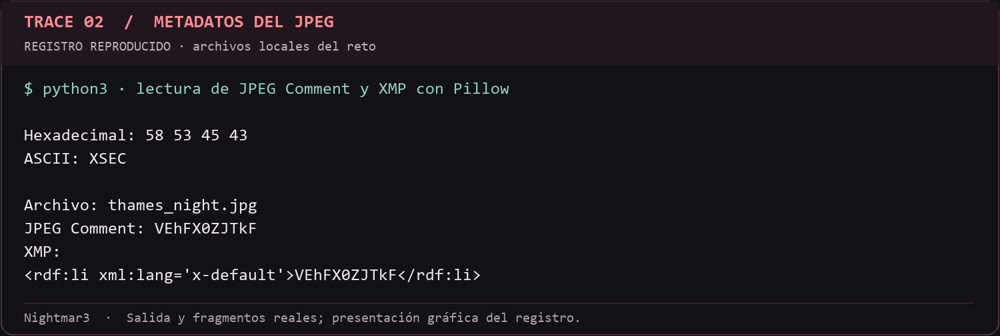

*Lectura real del comentario JPEG y del XMP de thames_night.jpg. Presentación gráfica de un registro reproducido, no captura histórica de una terminal.*

[Leer el registro en texto](evidence/trace02.txt).

**Evidencia que decide la contraseña.** Los cuatro valores al pie de la página son bytes hexadecimales. No representan coordenadas ni un PIN:

```sh
python3 -c "print(bytes.fromhex('58 53 45 43').decode('ascii'))"
# XSEC
```

Descarga y extrae el archivo, y examina los metadatos antes de modificar la fotografía:

```sh
curl -fL https://xsec-deep-trace-stage-1.vercel.app/evidence_001.zip -o evidence_001.zip
7z x evidence_001.zip -ounsealed
find unsealed -type f
# Localiza thames_night.jpg y usa su ruta en los comandos siguientes.
exiftool -a -u -g1 unsealed/evidence_001/thames_night.jpg
```

El ZIP revisado conserva el archivo en `evidence_001/thames_night.jpg`. La inspección recupera `VEhFX0ZJTkF` y datos GPS. Guarda el fragmento exactamente como aparece; su longitud de 11 caracteres explica por qué no debe tratarse como un mensaje Base64 independiente.

**Por qué funciona la extracción.** La pista produce `XSEC`; la variante en minúsculas `xsec` abre el contenido con steghide. La sensibilidad a mayúsculas se comprueba con el resultado, no se infiere del hexadecimal. Si ya existe `trace.txt`, utiliza otro nombre para no confundirlo con el `trace.txt` de TRACE 08.

**Cierre.** Destino: `dead-frequency.vercel.app`. Fragmento guardado: `VEhFX0ZJTkF`. La foto y sus metadatos siguen siendo relevantes más adelante; conserva el JPEG original sin recomprimirlo.

## TRACE 03 y 04 — La señal de audio y el libro de Mitnick

**TRACE 03** (`dead-frequency.vercel.app`). Se descargan `transmission.wav` y un ZIP cifrado con AES.

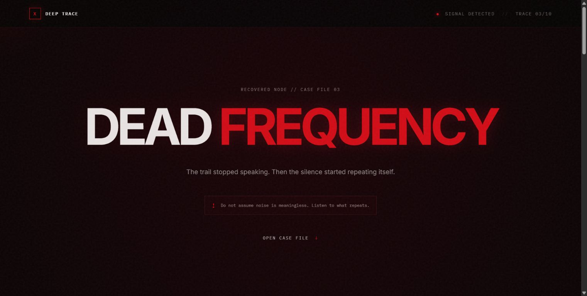

1. El WAV es Morse con un tono de 700 Hz: puntos de 80 ms y rayas de 240 ms. Se lee `SILENCEISNOTEMPTY`.
2. La pista *"Spaces were never part of the signal"* indica escribirlo sin espacios. Solo funciona en minúsculas: `silenceisnotempty`.
3. Dentro del ZIP hay `unwritten_signal.wav`. Su espectrograma, entre 4 y 18 kHz, dibuja un **QR de 29×29** que lleva a `https://unwritten-trace.vercel.app`.
4. El ZIP tiene 31 bytes después del End of Central Directory. Es un gzip que contiene el **fragmento `MX1RSQUNFX1`**.

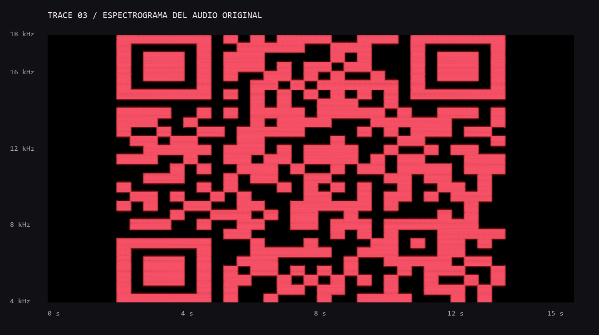

*Espectrograma generado de nuevo a partir de `unwritten_signal.wav`. No es una captura de Audacity: muestra la señal real entre 4 y 18 kHz.*


```sh
7z x -psilenceisnotempty recovered_archive.zip
python3 scripts/extract_zip_tail.py recovered_archive.zip
```

El espectrograma se conserva como evidencia visual; el extractor automático del QR no está incluido.

### TRACE 03 · Dos mensajes en el audio y otro al final del ZIP

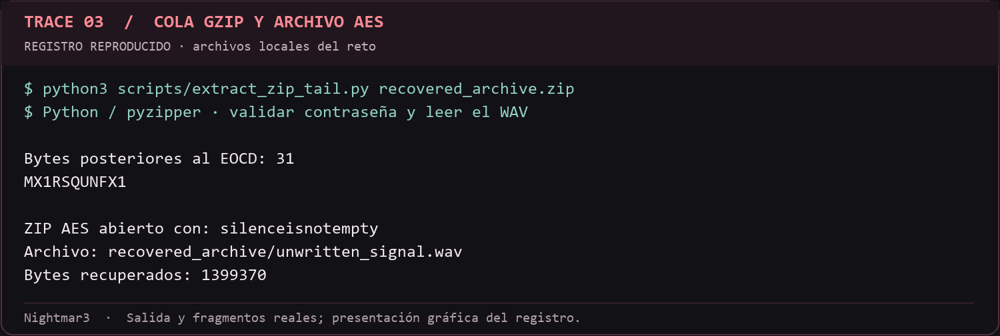

*Extracción del gzip posterior al EOCD y validación de la contraseña del ZIP AES. Presentación gráfica de un registro reproducido, no captura histórica de una terminal.*

[Leer el registro en texto](evidence/trace03.txt).

**Por qué medir los intervalos.** La página dirige la atención a la repetición y al tiempo. En la grabación, las duraciones cortas y largas guardan aproximadamente la proporción 1:3, compatible con Morse. Estas son las letras de la lectura recuperada:

```text
... .. .-.. . -. -.-. . .. ... -. --- - . -- .--. - -.--
 S   I   L  E  N   C  E  I  S  N   O   T E  M   P  T  Y
```

En Audacity, importa `transmission.wav`, amplía la forma de onda y mide varios pulsos: unos 0,08 s para puntos y 0,24 s para rayas. Separa las letras por las pausas más largas. La contraseña probada es `silenceisnotempty`, sin espacios.

**El segundo audio exige otra representación.** Tras abrir el ZIP, cambia `unwritten_signal.wav` a vista de espectrograma, con escala lineal y un rango que incluya 4–18 kHz. Ajusta el contraste hasta distinguir la cuadrícula y las tres marcas de posición del QR. Un espectrograma convierte frecuencia y tiempo en una imagen; escuchar el WAV no permite leer directamente esa figura. La investigación previa obtuvo `https://unwritten-trace.vercel.app` del QR; aquí se conserva un espectrograma recalculado, pero no un extractor automático del QR validado.

**El fragmento adicional no está dentro de los archivos listados.** El [extractor de la cola del ZIP](scripts/extract_zip_tail.py) calcula el final del EOCD incluyendo la longitud del comentario ZIP; evita asumir que el cierre ocupa siempre solo 22 bytes:

```sh
python3 scripts/extract_zip_tail.py recovered_archive.zip
# Bytes posteriores al EOCD: 31
# MX1RSQUNFX1
```

Esos bytes forman un gzip. El hecho de que `7z` abra el archivo no obliga a que todo su contenido esté representado en el listado del ZIP.

**Cierre.** Contraseña: `silenceisnotempty`. Destino: `unwritten-trace.vercel.app`. Fragmento: `MX1RSQUNFX1`.

**TRACE 04** (`unwritten-trace.vercel.app`). Las pistas citan a Kevin Mitnick, su libro *The Art of Invisibility* y una advertencia sobre "una torre pequeña". En el libro, esa torre es la **femtocell**: una mini estación celular que, modificada, puede interceptar llamadas. La siguiente etapa está en la ruta `/femtocell`.

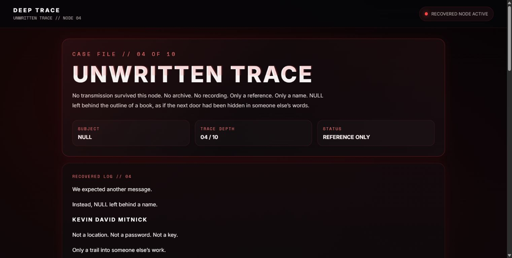

El **fragmento `JFUVVJUkVTX`** aparece como comentario al final de `script.js`.

### TRACE 04 · Convertir una referencia bibliográfica en una ruta

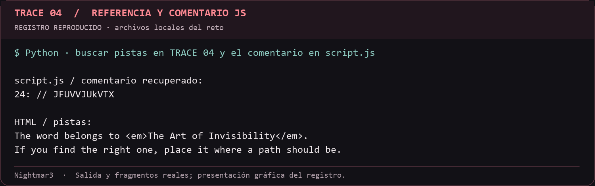

*Pistas del HTML y fragmento del JavaScript descargado. Presentación gráfica de un registro reproducido, no captura histórica de una terminal.*

[Leer el registro en texto](evidence/trace04.txt).

**Cómo acotar la búsqueda.** El nombre de Mitnick identifica al autor. Las pistas descartan *The Art of Deception* y *The Art of Intrusion*, y otra nota nombra explícitamente *The Art of Invisibility*. El objetivo es un término técnico, no el título del libro ni una frase completa. La alusión a una torre pequeña orienta hacia una estación celular de corto alcance: `femtocell`.

La relación con el libro pertenece al razonamiento de la investigación; no se dispone aquí de una página escaneada o de un número de página verificado. La comprobación reproducible es que la palabra, colocada como ruta, abre el nodo llamado **RESIDUAL SIGNAL**:

```sh
curl -fL https://unwritten-trace.vercel.app/femtocell -o trace05.html
grep -n 'RESIDUAL SIGNAL' trace05.html
curl -fL https://unwritten-trace.vercel.app/script.js -o trace04-script.js
grep -n 'JFUVVJUkVTX' trace04-script.js
```

La última línea del JavaScript descargado contiene `// JFUVVJUkVTX`. El comentario no se ejecuta ni aparece en el texto visible, pero sí forma parte del recurso entregado al navegador.

**Cierre.** Ruta: `/femtocell`. Fragmento: `JFUVVJUkVTX`. La palabra funciona como ubicación del siguiente nodo, no como contraseña de un archivo.

## TRACE 05 y 06 — Paquetes fantasma y vuelta a la evidencia

**TRACE 05** (`/femtocell`, "RESIDUAL SIGNAL"). Hay dos artefactos del mismo evento: un proceso Python dañado, `trace.py`, y una captura de red, `capture.pcap`. La pista: *"Two records. One event."*

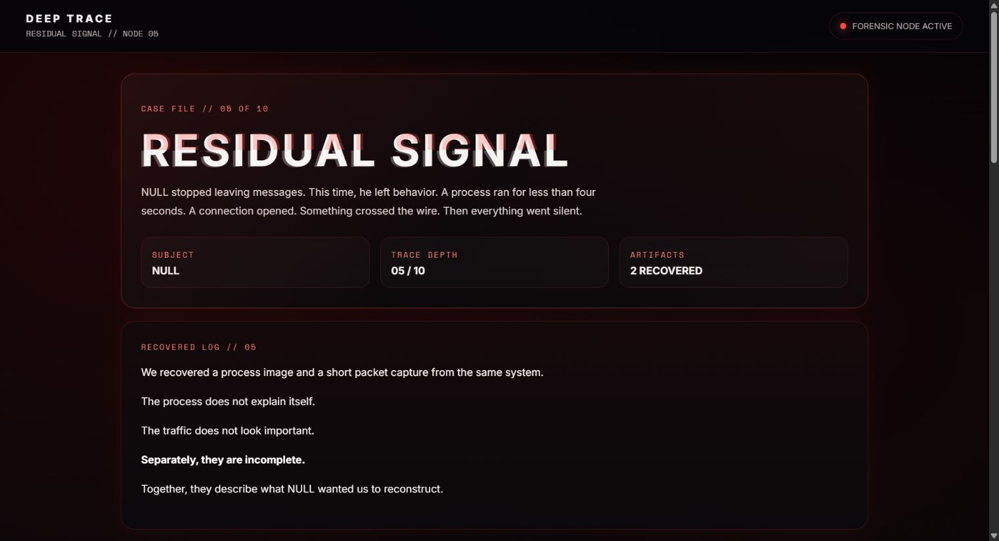

1. En la captura, 16 paquetes UDP van al puerto 4444, con TTL 42 e IP ID del 1 al 16, pero desordenados en el archivo.
2. Ordenados por IP ID, su byte de payload forma `cGFja2V0Z2hvc3Q=`, que en Base64 es **`packetghost`**.
3. `trace.py` contiene un señuelo, `ghostpacket`, y el nonce `NULLTRACE5`. El flujo de descifrado es SHA256(`packetghost|NULLTRACE5` + contador de 4 bytes), concatenando bloques. Con XOR sobre el bloque cifrado sale `https://return-to-evidence.vercel.app/`.
4. El **fragmento `0VWRVJZX0ZS`** está en un comentario CSS: `/* 0VWRVJZX0ZS */`.

```sh
tshark -r capture.pcap -Y 'udp.dstport == 4444 && ip.ttl == 42' \
  -T fields -E separator=, -e ip.id -e udp.payload \
  | python3 scripts/decode_pcap.py
```

Los scripts auxiliares disponibles se enlazan en el procedimiento de la etapa.

### TRACE 05 · Restaurar el orden y usar la clave externa

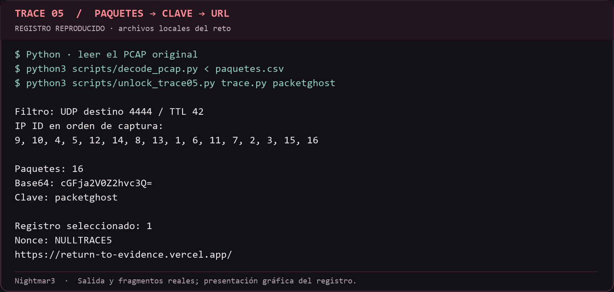

*Lectura del PCAP original, orden de los paquetes y descifrado con packetghost. Presentación gráfica de un registro reproducido, no captura histórica de una terminal.*

[Leer el registro en texto](evidence/trace05.txt).

**Qué aporta cada artefacto.** El proceso contiene `_FALSE = "ghostpacket"` y una rama marcada como señuelo. Su función de descifrado recibe un parámetro `external`: el programa no proporciona por sí solo la clave correcta. La captura aporta esa pieza. Entre el tráfico, el conjunto seleccionado tiene destino UDP 4444, TTL 42 e identificadores IP 1–16; cada payload contiene un byte. Esta combinación produce una secuencia comprobable al ordenar, no solo una selección que parece interesante.

```sh
curl -fL https://unwritten-trace.vercel.app/femtocell/capture.pcap -o capture.pcap
curl -fL https://unwritten-trace.vercel.app/femtocell/trace.py -o trace.py
tshark -r capture.pcap -Y 'udp.dstport == 4444 && ip.ttl == 42' \
  -T fields -E separator=, -e ip.id -e udp.payload
```

Los identificadores pueden imprimirse en hexadecimal. El [decodificador de paquetes](scripts/decode_pcap.py) los convierte a números antes de ordenar: un orden lexicográfico o `sort -n` sobre valores `0x…` puede mezclar la secuencia. Repite el comando anterior canalizando su salida al script, como en el bloque de esta etapa.

```text
Paquetes: 16
Base64: cGFja2V0Z2hvc3Q=
Clave: packetghost
```

**Muestra de la evidencia de red.** Los primeros cuatro paquetes que cumplen el filtro aparecen así en el PCAP examinado:

| Posición entre los paquetes filtrados | IP ID | Payload hexadecimal | Carácter |
| --- | ---: | --- | --- |
| 1 | 9 | `5a` | `Z` |
| 2 | 10 | `32` | `2` |
| 3 | 4 | `6a` | `j` |
| 4 | 5 | `61` | `a` |

El comienzo leído en orden de captura es `Z2ja`; el mensaje empieza por `cGFj` después de ordenar por IP ID. Esta diferencia muestra por qué importa reconstruir el orden antes de decodificar.

**De la clave al texto claro.** `_pick()` selecciona el segundo registro, índice 1. El programa añade el nonce `NULLTRACE5`, permuta los bytes con `_twist()` y los empaqueta en Base85. `_unlock()` deshace Base85 y la permutación antes de separar nonce y cuerpo. Por eso el registro cifrado seleccionado se puede descifrar directamente con el mismo flujo SHA256, sin reproducir el empaquetado.

El [script de descifrado del registro](scripts/unlock_trace05.py) lee `_R` sin ejecutar el proceso recuperado y aplica la fórmula documentada:

```sh
python3 scripts/unlock_trace05.py trace.py packetghost
# Registro seleccionado: 1
# Nonce: NULLTRACE5
# https://return-to-evidence.vercel.app/
curl -fL https://unwritten-trace.vercel.app/femtocell/styles.css -o trace05-styles.css
grep -n '0VWRVJZX0ZS' trace05-styles.css
```

**Cierre.** Clave externa: `packetghost`. Destino: `return-to-evidence.vercel.app`. Fragmento: `0VWRVJZX0ZS`. `ghostpacket` es una constante del señuelo y no sustituye a la clave recuperada de los paquetes.

**TRACE 06** ("RETURN TO EVIDENCE"). La página pide volver atrás: *"One of the earliest artifacts… carried more than it appeared to"*, *"Location is also data"* y *"When the image returns, measure it"*.

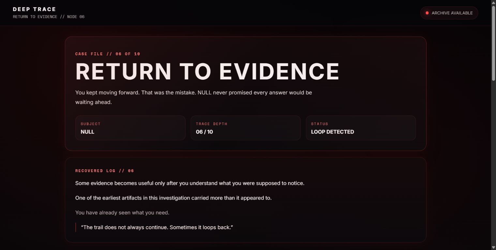

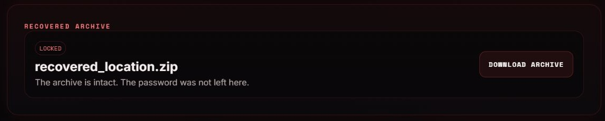

*Las notas conectan tres operaciones: volver a una evidencia anterior, identificar su ubicación y medir la imagen que devuelve el archivo.*

1. La contraseña de `recovered_location.zip` es el edificio de `thames_night.jpg`: **`Palace of Westminster`**.
2. Dentro está `evidence_returned.jpg`, un recorte del Big Ben de **37×41 píxeles**.
3. El comentario HTML dice `Make sure you multiplied the numbers you got`: 37 × 41 = **1517**, y la siguiente etapa está en `/1517`.

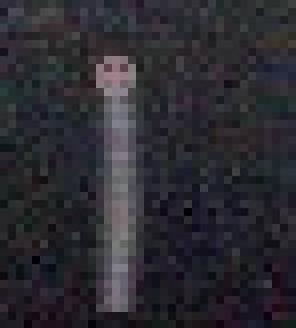

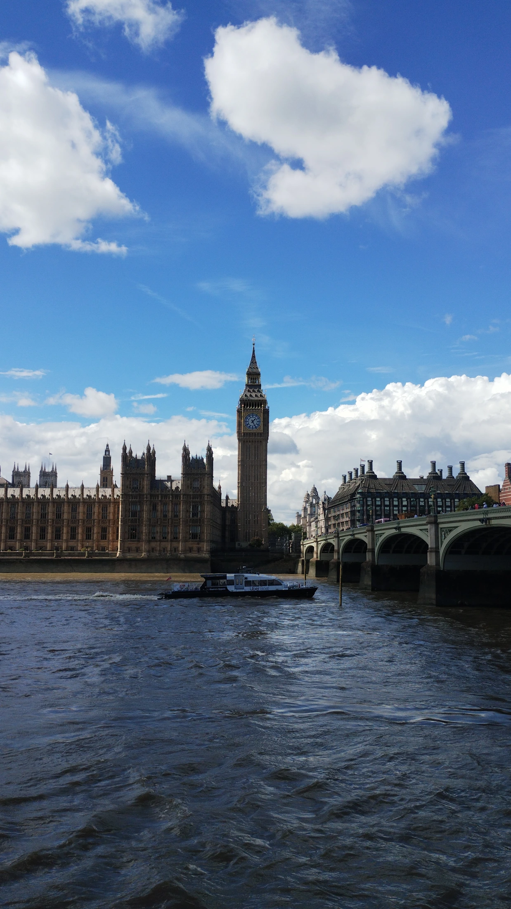

*Fotografía de referencia: CubicPioneer, [Wikimedia Commons](https://commons.wikimedia.org/wiki/File:Elizabeth_Tower_and_Palace_of_Westminster_from_the_River_Thames.jpg), CC0. Esta imagen ilustra el edificio; no sustituye al JPEG original del reto ni contiene sus pistas.*

```sh
7z x '-pPalace of Westminster' recovered_location.zip
exiftool -ImageWidth -ImageHeight recovered_location/evidence_returned.jpg
```

**Avanzar y recuperar un fragmento son objetivos diferentes.** La ruta `/1517` confirma que las dimensiones resolvieron el salto al nodo 07; no demuestra que se haya localizado toda la evidencia de TRACE 06. Los 37 × 41 corresponden al JPEG extraído, no a la fotografía original. La ampliación de la imagen solo facilita verla y no cambia sus dimensiones.

En esta etapa no apareció fragmento: ni en HTML, JS o CSS, ni en el ZIP o la imagen. Se reconstruyó más tarde (ver Fragmentos acumulativos).

### TRACE 06 · Reabrir la evidencia y medir el archivo correcto

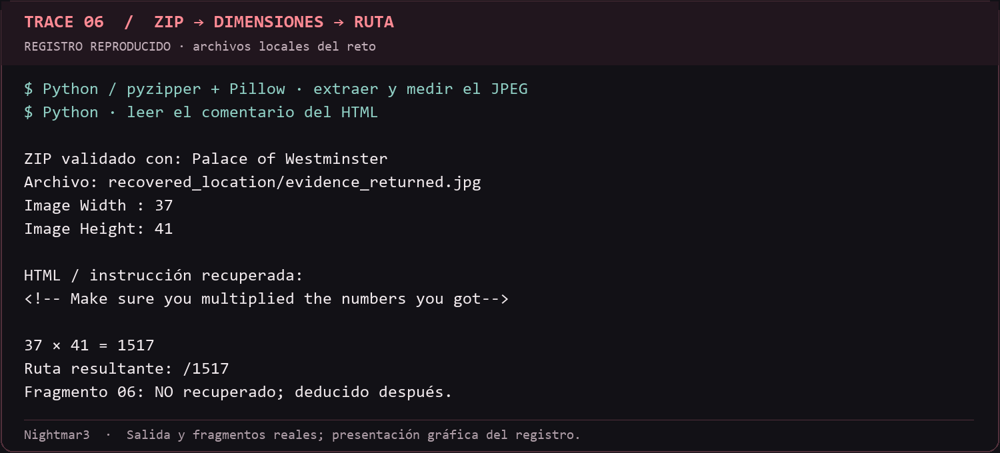

*ZIP abierto, dimensiones del JPEG extraído y comentario HTML que indica multiplicarlas. Presentación gráfica de un registro reproducido, no captura histórica de una terminal.*

[Leer el registro en texto](evidence/trace06.txt).

**La pista conecta archivos de distintas etapas.** La referencia a un artefacto temprano y a la ubicación invita a revisar `thames_night.jpg`, guardado en TRACE 02. Su escena permite proponer el Palacio de Westminster. La frase exacta `Palace of Westminster`, con sus espacios y mayúsculas, se valida al abrir el ZIP; la identificación visual por sí sola no prueba una contraseña.

```sh
curl -fL https://return-to-evidence.vercel.app/recovered_location.zip -o recovered_location.zip
7z t '-pPalace of Westminster' recovered_location.zip
7z x '-pPalace of Westminster' recovered_location.zip -ounsealed
exiftool -ImageWidth -ImageHeight unsealed/recovered_location/evidence_returned.jpg
# Image Width : 37
# Image Height: 41
curl -fL https://return-to-evidence.vercel.app/ -o trace06.html
grep -n 'multiplied' trace06.html
```

El HTML contiene `<!-- Make sure you multiplied the numbers you got-->`. Esa instrucción relaciona los números de la imagen con una operación concreta:

```sh
python3 -c 'print(37 * 41)'
# 1517
curl -fL https://return-to-evidence.vercel.app/1517 -o trace07.html
grep -n 'SPLIT SIGNAL' trace07.html
```

**Qué quedó pendiente.** La apertura del ZIP y la llegada a SPLIT SIGNAL prueban el avance. Las búsquedas de la investigación no localizaron el fragmento 06. En las comprobaciones aportadas, no había bytes tras el EOCD del ZIP ni tras el último EOI del JPEG, y steghide no extrajo datos con las contraseñas probadas. Estos resultados descartan esas pruebas concretas; no demuestran que la imagen carezca de cualquier contenido oculto.

**Cierre.** Contraseña del ZIP: `Palace of Westminster`. Dimensiones originales: 37 × 41. Ruta: `/1517`. Fragmento 06: **no recuperado de una fuente original; deducido posteriormente**.

## TRACE 07 — Split Signal: LinkedIn + Instagram

La URL de TRACE 08 estaba partida en dos publicaciones de XSec Solutions, cifradas con XOR y la clave `publicshadow`. Las pistas: *"One was meant to be read. One was meant to be seen"*, *"Same source. Different channels"* y *"Public does not mean obvious"*.

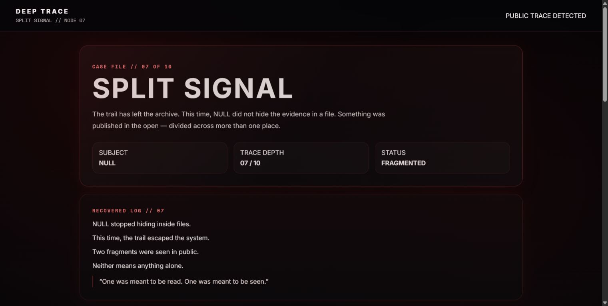

- **El fragmento acumulativo `FWT1FVkVSWV`** está en un párrafo con texto negro sobre fondo oscuro, junto a la indicación *"Select All"*.
- **LinkedIn ("para leer"):** `ET0wXAorPl4tHVYNESIwACU0PQc4M1oC`
- **Instagram ("para ver"):** el hashtag `#KiIVGQ0OJRE4VjkEPBgkGwogS1U=` en el post "2 DAYS LEFT"; la fecha de edición no está verificada en los artefactos adjuntos.

**Cómo se obtuvo la clave (texto conocido).** La cadena de LinkedIn decodifica a 24 bytes binarios. Al probar palabras de las pistas como clave XOR, `public` dio `aHR0cHN…`, que se parece al Base64 de `https`. Si la dirección esperada empieza por `https://`, cuyo Base64 es `aHR0cHM6Ly9`. Al hacer XOR del texto cifrado con ese inicio aparece la clave: `publicshado…`, es decir, `publicshadow`.

```sh
python3 - <<'E'
import base64
k = b'publicshadow'
for c in ['ET0wXAorPl4tHVYNESIwACU0PQc4M1oC', 'KiIVGQ0OJRE4VjkEPBgkGwogS1U=']:
    b = base64.b64decode(c)
    print(base64.b64decode(bytes(x ^ k[i % 12] for i, x in enumerate(b))))
E
# b'https://side-chann'  +  b'el.vercel.app/'
```

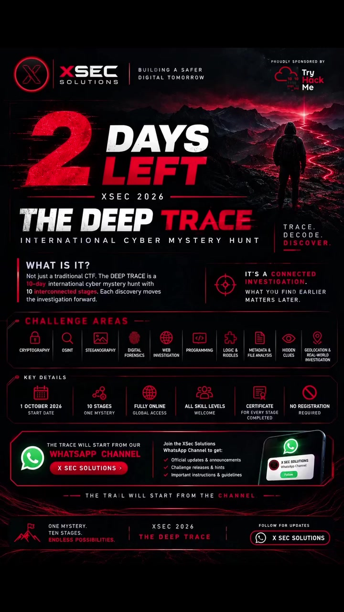

*El cartel identifica la publicación. La cadena cifrada estaba en el caption como hashtag, por lo que había que revisar también el texto del post.*

En orden, LinkedIn y luego Instagram forman `https://side-channel.vercel.app/`.

### TRACE 07 · Separar el enlace partido del mensaje acumulativo

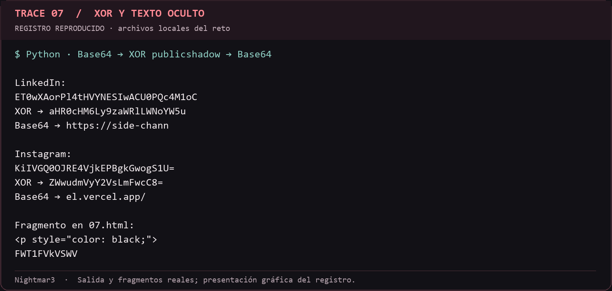

*Dos decodificaciones Base64 con XOR intermedio y evidencia del texto negro en el HTML. Presentación gráfica de un registro reproducido, no captura histórica de una terminal.*

[Leer el registro en texto](evidence/trace07.txt).

**Hay dos clases de fragmentos.** Los dos textos publicados en redes completan la URL de TRACE 08. El texto negro del HTML aporta otra pieza, `FWT1FVkVSWV`, destinada al mensaje final. No se deben intercambiar ni contar como el mismo hallazgo.

La expresión «para ver» orientó la búsqueda hacia Instagram, pero el hallazgo documentado fue un **hashtag del caption**, no una cadena recuperada de los píxeles del cartel. El póster identifica la publicación; no prueba por sí solo el texto del caption.

**Las capas exactas son Base64 → XOR → Base64.** La primera decodificación produce bytes binarios. XOR con la clave repetida `publicshadow` devuelve otra cadena Base64; hay que decodificarla una segunda vez. El bloque de esta etapa muestra las dos cadenas de entrada y las salidas parciales. Unirlas en el orden inverso produce una dirección inválida.

Para conservar la pieza del HTML sin depender del contraste del monitor:

```sh
curl -fL https://return-to-evidence.vercel.app/1517 -o trace07.html
grep -n -B 2 -A 2 'FWT1FVkVSWV' trace07.html
```

La evidencia descargada muestra `<p style="color: black;">` alrededor del fragmento, junto a la indicación `Select All`. Las cadenas de redes están transcritas en este writeup; no se adjunta una exportación completa de ambas publicaciones que permita verificar sus fechas o historial de edición.

**Cierre.** LinkedIn: `https://side-chann`. Instagram: `el.vercel.app/`. Destino unido: `https://side-channel.vercel.app/`. Fragmento acumulativo independiente: `FWT1FVkVSWV`.

## TRACE 08 — Side Channel: la sala de TryHackMe

La dirección de TRACE 09 sale de la flag de una encuesta de TryHackMe: `THM{we_will_be_back_in_2025}` da **`we-will-be-back-in-2027.vercel.app`**. La primera flag que probamos era correcta en TryHackMe, pero no era la que llevaba a la siguiente etapa.

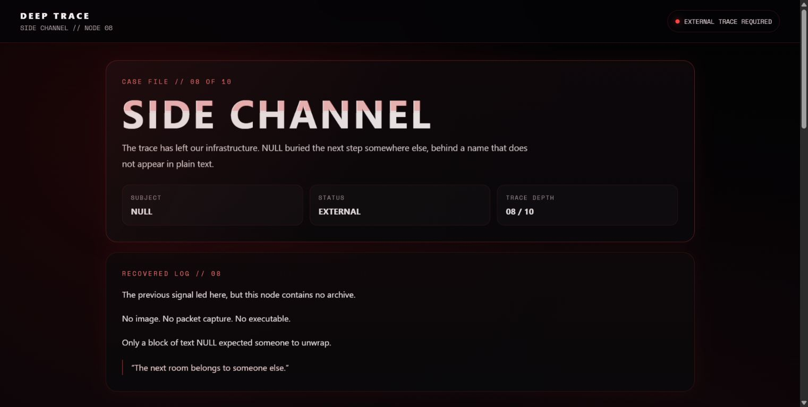

**El intercept.** Las pistas indican tres capas: *"The outer layer is only packaging"* (Base64), *"The second layer reads the wrong way"* (invertir) y *"NULL still signs his work"* (Vigenère `NULL`).

```text
TkZQRksgUk9UTSA0MjAyIEVQTVNQIFFaIE5BUEdYTg==
→ Base64:    NFPFK ROTM 4202 EPMSP QZ NAPGXN
→ invertir:  NXGPAN ZQ PSMPE 2024 MTOR KFPFN
→ Vigenère:  ADVENT OF CYBER 2024 SIDE QUEST
```

**Las instrucciones para la dirección:**

- *"A flag has an outside and an inside. Only one of them belongs in an address."* Se quita `THM{…}`.
- *"The message remembers 2025. The next trace does not. Move the year two steps forward."* 2025 pasa a 2027.

**El callejón sin salida.** La sala *Advent of Cyber '24 Side Quest* tiene una Task 9, "The End?", con una encuesta. Su flag, `THM{bigger_and_maybe_not_as_mean_in_2025}`, la acepta TryHackMe. Pero `bigger-and-maybe-not-as-mean-in-2027.vercel.app` no existe. Se probaron más de 300 variantes, todas con 404:

- separadores y mayúsculas;
- otros años;
- otros servicios de hosting;
- rutas dentro de los dominios del reto;
- salas de TryHackMe con ese nombre.

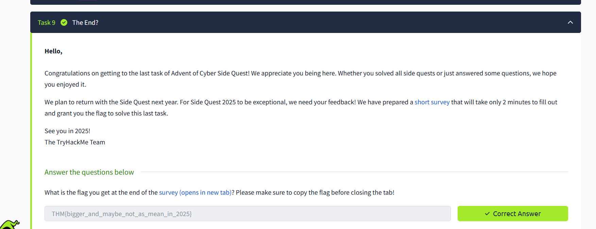

*Una respuesta aceptada confirma la tarea de TryHackMe, pero no que esa misma cadena produzca el siguiente dominio del concurso.*

**La solución.** Un writeup público del Side Quest da otra flag de encuesta: `THM{we_will_be_back_in_2025}`, según la investigación previa; su procedencia exacta está pendiente de reconfirmación. *"We will be back in 2025"* es literalmente "el mensaje que recuerda 2025".

```text
THM{we_will_be_back_in_2025} → we_will_be_back_in_2025 → we-will-be-back-in-2027
→ https://we-will-be-back-in-2027.vercel.app/
```

El **fragmento `9BQ1RJT05f`** está en `side-channel.vercel.app/trace.txt`. La página lo carga en segundo plano desde `script.js` con un `fetch()`, sin mostrarlo.

### TRACE 08 · Comprobar cada capa y cuestionar la flag de partida

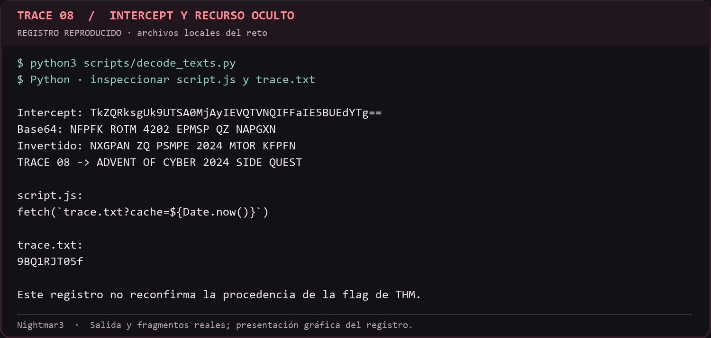

*Transformaciones del intercept y recurso trace.txt observado en el JavaScript. Presentación gráfica de un registro reproducido, no captura histórica de una terminal.*

[Leer el registro en texto](evidence/trace08.txt).

**El intercept identifica una sala, no un dominio.** Primero se decodifica Base64, después se invierte la cadena completa, incluidos espacios y cifras, y finalmente se descifran las letras con Vigenère. Así, `4202` pasa a `2024` antes de aplicar `NULL`. La salida del script textual debe ser:

```text
TRACE 08 -> ADVENT OF CYBER 2024 SIDE QUEST
```

**La flag requiere una comprobación separada.** La captura de TryHackMe demuestra que `THM{bigger_and_maybe_not_as_mean_in_2025}` fue aceptada en Task 9. No demuestra que produzca el dominio del concurso. El recorrido que llegó al nodo 09 utilizó `THM{we_will_be_back_in_2025}`: retirar el envoltorio, adelantar el año dos posiciones y normalizar los separadores da el dominio publicado. La regla de reemplazar guiones bajos por guiones queda validada por el destino alcanzado; no se presenta aquí como una cita literal del reto.

La procedencia exacta de esa segunda flag sigue pendiente de reconfirmación. Es una limitación del paso entre la sala y el dominio, aunque las transformaciones del intercept y la existencia del nodo siguiente sí se pueden reproducir. No hace falta presentar como requisito resolver todos los laboratorios del Side Quest: este expediente no documenta esa resolución completa.

**El fragmento se obtiene de un recurso adicional.** En el JavaScript observado aparece ``fetch(`trace.txt?cache=${Date.now()}`)``; el resultado no se inserta en el documento visible:

```sh
curl -fL https://side-channel.vercel.app/trace.txt
# 9BQ1RJT05f
curl -fL https://we-will-be-back-in-2027.vercel.app/ -o trace09.html
grep -n 'THE PAGE THAT FORGOT' trace09.html
```

**Cierre.** Sala indicada: Advent of Cyber 2024 Side Quest. Destino alcanzado: `we-will-be-back-in-2027.vercel.app`. Fragmento: `9BQ1RJT05f`. Procedencia de la flag utilizada: pendiente de reconfirmación.

## TRACE 09 y 10 — La página que olvidó y el nodo final

**TRACE 09** ("THE PAGE THAT FORGOT"). La página dice *"What you are looking for is not in this version"* y *"Some pages are written for visitors. Others are noticed only by things that crawl"*.

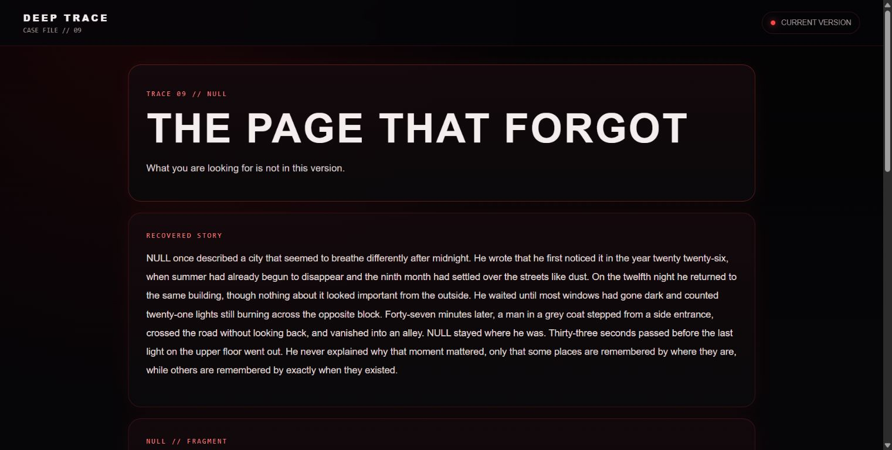

1. Lo que rastrea las webs son los buscadores, y lo que leen primero es `robots.txt`. Contiene `Disallow: /records/`.
2. `/records/` explica: *"Preserved versions are stored beneath the moment they were captured. /records/&lt;timestamp&gt;/"*.
3. El timestamp está escrito con palabras en la historia de NULL:

| Texto de la historia | Valor |
| --- | --- |
| "the year twenty twenty-six" | 2026 |
| "the ninth month" | 09 |
| "On the twelfth night" | 12 |
| "twenty-one lights" | 21 (hora) |
| "Forty-seven minutes later" | 47 (minutos) |
| "Thirty-three seconds passed" | 33 (segundos) |

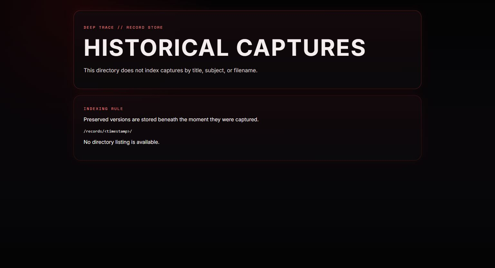

La historia aporta los valores; esta página explica cómo convertirlos en una ruta. Se concatenan como `YYYYMMDDhhmmss`, con dos dígitos para mes, día, hora, minuto y segundo. No se realiza una conversión de zona horaria.

Resultado: `https://we-will-be-back-in-2027.vercel.app/records/20260912214733/`

### TRACE 09 · Extraer el momento de captura sin adivinar rutas

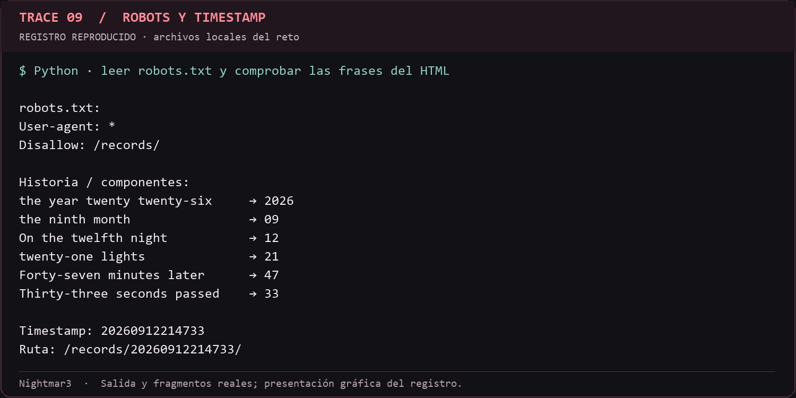

*Directiva de robots.txt y valores comprobados en la historia del HTML. Presentación gráfica de un registro reproducido, no captura histórica de una terminal.*

[Leer el registro en texto](evidence/trace09.txt).

**Por qué `robots.txt`.** La alusión a quienes rastrean páginas apunta a un recurso que contiene directivas para crawlers. `Disallow` indica una ruta; no es una contraseña ni una barrera técnica de acceso. Se consulta el recurso público sugerido por la pista:

```sh
curl -fL https://we-will-be-back-in-2027.vercel.app/robots.txt
# User-agent: *
# Disallow: /records/
curl -fL https://we-will-be-back-in-2027.vercel.app/records/
```

La página de `records` proporciona la plantilla y la historia aporta los seis valores de la tabla. El orden de aparición permite construir `2026` + `09` + `12` + `21` + `47` + `33`. No se suma «47 minutos» a otra hora: en la solución estos valores se leen como componentes del identificador de captura.

```sh
curl -fL https://we-will-be-back-in-2027.vercel.app/records/20260912214733/ -o trace10.html
grep -n -E 'FINAL NODE|TEVBVkVTX0|residue://10' trace10.html
```

**Qué cambia entre versiones.** La página actual se titula THE PAGE THAT FORGOT y conserva la historia. La ruta archivada se identifica como FINAL NODE, TRACE 10, y contiene los dos comentarios que cierran el mensaje. Es un archivo publicado por el propio reto bajo `records`; no se utilizó Wayback Machine para encontrarlo.

**Cierre.** Timestamp: `20260912214733`. Destino: `/records/20260912214733/`. La pieza atribuida a TRACE 09, `TEVBVkVTX0`, se recupera en ese documento; no aparece en la versión actual examinada.

**TRACE 10** ("FINAL NODE"). La página esconde los dos últimos fragmentos en comentarios HTML: `<!--TEVBVkVTX0 -->` y `<!-- residue://10 FfVFJBQ0U= -->`. Las pistas dicen:

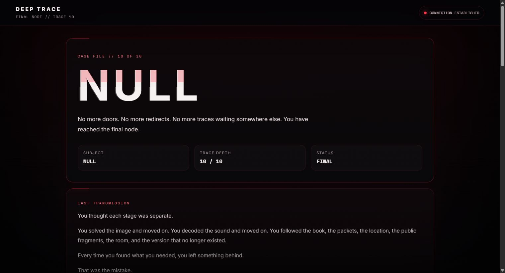

- No leer los fragmentos por separado.
- El orden es el del recorrido.
- La clave descodificada no es el destino: *"Keys leave fingerprints too"* y *"Encode the final key into md5"*.
- *"Let those 32 marks stand before .vercel.app"*: el MD5 tiene 32 caracteres.

```sh
# Clave: la parte tras KEY= del mensaje reconstruido
echo -n 'EVERY_ACTION_LEAVES_A_TRACE' | md5sum
# 1b74e5175e672a5af64c7ea7808801e7
```

Página final: `https://1b74e5175e672a5af64c7ea7808801e7.vercel.app/`, con el título "DEEP TRACE // Completed" y el formulario oficial de ganador. El MD5 del mensaje completo no existe como dominio; solo funciona el de la clave.

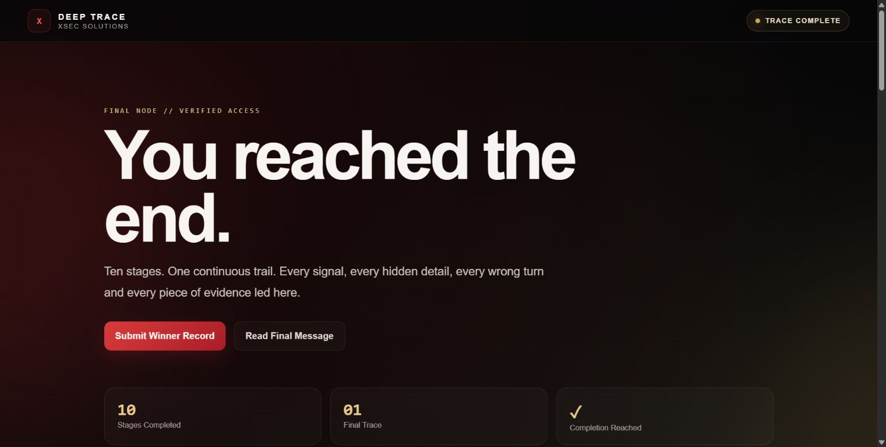

### TRACE 10 · Reconstruir antes de calcular la huella

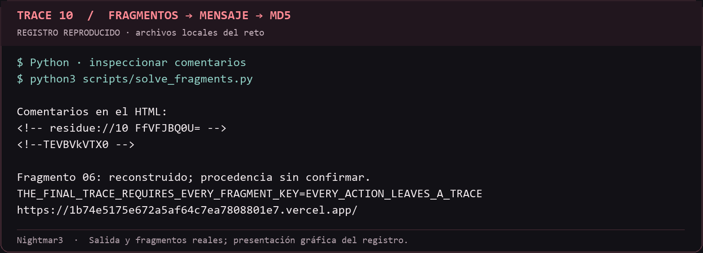

*Comentarios del nodo final y ejecución del script que reconstruye la clave y calcula su MD5. Presentación gráfica de un registro reproducido, no captura histórica de una terminal.*

[Leer el registro en texto](evidence/trace10.txt).

**La evidencia está en el código fuente.** El mismo documento contiene `<!--TEVBVkVTX0 -->` junto al relato y `<!-- residue://10 FfVFJBQ0U= -->` cerca del inicio. La posición física de los comentarios no determina su orden: el writeup utiliza el recorrido de las etapas y la marca `residue://10` para situar la última pieza.

La secuencia conservada contiene nueve fragmentos, correspondientes a TRACE 02–10. Una pista de la página habla de «nine pieces» anteriores y una adicional; ese conteo literal no coincide con las nueve piezas utilizadas aquí. Se conserva la discrepancia en vez de inventar un fragmento para completarla. La secuencia y la clave mostradas sí llevan a la página de finalización.

**Cómo repetir la reconstrucción.** Descarga el [script de fragmentos](scripts/solve_fragments.py), que incluye explícitamente la pieza 06 deducida:

```sh
python3 scripts/solve_fragments.py
# Fragmento 06: reconstruido; procedencia sin confirmar.
# THE_FINAL_TRACE_REQUIRES_EVERY_FRAGMENT_KEY=EVERY_ACTION_LEAVES_A_TRACE
# https://1b74e5175e672a5af64c7ea7808801e7.vercel.app/
```

Concatena primero y decodifica después. El `=` de padding corresponde al final de toda la cadena; añadir padding a cada pieza puede ocultar un error de alineación. Del mensaje decodificado se toma únicamente lo que sigue a `KEY=`. Para calcular la huella en Linux:

```sh
printf '%s' 'EVERY_ACTION_LEAVES_A_TRACE' | md5sum
# 1b74e5175e672a5af64c7ea7808801e7
```

`printf '%s'` no añade salto de línea. Cambiar mayúsculas, incluir comillas en los bytes o hashear el mensaje completo produce otra huella. MD5 es aquí la transformación indicada por el acertijo; no se necesita romper el hash ni buscar colisiones.

**Cierre.** La URL resultante abre una página titulada DEEP TRACE // Completed. Ese resultado confirma la clave utilizada, pero no localiza ni autentica de forma independiente el fragmento 06 que quedó reconstruido. El formulario de finalización pertenece al flujo del concurso y no se completa como parte de esta reproducción.

## Fragmentos acumulativos

Los 9 fragmentos, concatenados en orden y decodificados juntos, forman `THE_FINAL_TRACE_REQUIRES_EVERY_FRAGMENT_KEY=EVERY_ACTION_LEAVES_A_TRACE`. Por separado no se pueden leer: cada corte cae en mitad de un grupo Base64.

| Etapa | Fragmento | Dónde estaba |
| --- | --- | --- |
| 02 | `VEhFX0ZJTkF` | EXIF, XMP y comentario de `thames_night.jpg` |
| 03 | `MX1RSQUNFX1` | gzip tras el EOCD de `recovered_archive.zip` |
| 04 | `JFUVVJUkVTX` | comentario `//` en `script.js` |
| 05 | `0VWRVJZX0ZS` | comentario `/* */` en `styles.css` |
| 06 | `QUdNRU5UX0t` | reconstruido (no encontrado) |
| 07 | `FWT1FVkVSWV` | texto negro sobre negro en `/1517` |
| 08 | `9BQ1RJT05f` | `side-channel.vercel.app/trace.txt` |
| 09 | `TEVBVkVTX0` | comentario HTML en `/records/20260912214733/` |
| 10 | `FfVFJBQ0U=` | comentario `residue://10` en la misma página |

```sh
python3 -c "import base64;print(base64.b64decode('VEhFX0ZJTkFMX1RSQUNFX1JFUVVJUkVTX0VWRVJZX0ZSQUdNRU5UX0tFWT1FVkVSWV9BQ1RJT05fTEVBVkVTX0FfVFJBQ0U='))"
```

**Cómo se reconstruyó el fragmento 06.** Base64 convierte cada 3 bytes en 4 caracteres, así que solo se lee bien cuando los cortes caen en su sitio.

- Los fragmentos 02 a 05 suman 44 caracteres y dan `THE_FINAL_TRACE_REQUIRES_EVERY_FR`.
- Los fragmentos 07 y 08 solo se leen bien desplazados 3 caracteres, como `…Y=EVERY_ACTION_`.
- Para que encajen, entre ambos falta exactamente un fragmento de 11 caracteres. Debe codificar 8 letras más 2 bits, y esos bits obligan a que la letra siguiente sea una `E`.
- La reconstrucción semántica utilizada es `FR` + `AGMENT_K` + `EY=`, que en Base64 es `QUdNRU5UX0t`.

El MD5 confirma la clave final, pero no valida de forma independiente el fragmento 06: se calcula únicamente sobre la parte posterior a `KEY=`. El fragmento sigue siendo una reconstrucción sin fuente original localizada.

## Lecciones aprendidas y callejones sin salida

Lo que más tiempo costó no fue técnico: fue dar por buena la primera flag del Stage 8 sin cuestionarla.

| Callejón | Por qué falló | Lección |
| --- | --- | --- |
| `XSEC` como contraseña de steghide | Steghide distingue mayúsculas; era `xsec` | Prueba siempre las variantes de mayúsculas de una pista |
| RockYou y diccionarios con CeWL en TRACE 02 | La clave estaba en la propia página | En un reto encadenado, deriva la clave de las pistas antes de usar fuerza bruta |
| Buscar el fragmento 06 en cada archivo | No se localizó en los archivos examinados | La estructura del Base64 permite deducir lo que falta |
| `bigger_and_maybe_not_as_mean_in_2027` | Respuesta aceptada en THM; procedencia de la segunda flag pendiente de confirmar | Si 300 variantes fallan, revisa la suposición, no el formato |
| Pensar que el Stage 9 no estaba publicado | Otros participantes ya habían llegado | Usa los datos de los organizadores para descartar hipótesis |

**Técnicas reutilizables:**

- **Texto conocido contra XOR:** si sabes cómo empieza el mensaje (`https://` → `aHR0cHM6Ly9`), sacas la clave.
- **Alineación de Base64:** revela si dos trozos son contiguos y cuánto falta entre ellos.
- **Revisar todo lo que carga una página:** `robots.txt`, el JS (`fetch` ocultos), comentarios HTML y CSS, texto del mismo color que el fondo y estilos sin uso.
- **Datos tras el final de un archivo:** bytes después del EOCD de un ZIP o del EOI de un JPEG.
- **Espectrogramas:** un audio puede contener una imagen, como un QR.
- **Ordenar paquetes por un campo de cabecera:** el IP ID devolvió el orden real del mensaje.

## Integridad de los artefactos

Estos SHA256 identifican los archivos examinados para esta edición. Permiten comparar una descarga o copia local; no sustituyen la comprobación de su origen. El hash del JPEG corresponde al original, no a su ampliación para la web.

| Archivo | Bytes | SHA256 |
| --- | ---: | --- |
| `thames_night.jpg` | 606478 | `dd17c7f47ca8bf317d99d87a13107889dedc0a5564f2a957b2449e8a05ff3f83` |
| `transmission.wav` | 1205330 | `440123404f237152eaf6ac5fdabba1f325fca4d5abffaec31184905b0de531f6` |
| `recovered_archive.zip` | 280756 | `c046c001dd9bacd5dcf7b1a43b0deefadb05b973af3047fbf675774d8ab712a9` |
| `capture.pcap` | 7974 | `4214dd6ae38e3b9d63392042e80849e5255b4a6f04b0f4d00703fe73315d32c9` |
| `trace.py` | 2713 | `a8fa5dacaedf4693a08979098bb5c80d7e2a16a551649d771673df138309354d` |
| `recovered_location.zip` | 3141 | `a0a41641b5861ad16d02941b42649045ac1d47dd5b3e939e27b25f45bb88a52b` |
| `evidence_returned.jpg` | 7132 | `f4c405418c3ef00288ea053d813633031078270500a9cf569221fb4275526585` |

```sh
sha256sum thames_night.jpg transmission.wav recovered_archive.zip capture.pcap trace.py recovered_location.zip
```

## Fuentes

- [TryHackMe — Advent of Cyber '24 Side Quest](https://tryhackme.com/room/adventofcyber24sidequest)
- [motasem-notes.net — TryHackMe Advent of Cyber '24 Side Quest](https://motasem-notes.net/tryhackme-advent-of-cyber-2024-side-quest/), fuente atribuida en el original a `THM{we_will_be_back_in_2025}`; pasaje exacto pendiente de reconfirmación
- [Kevin Mitnick — The Art of Invisibility (Google Books)](https://books.google.com/books/about/The_Art_of_Invisibility.html?id=nBBeDAAAQBAJ)
